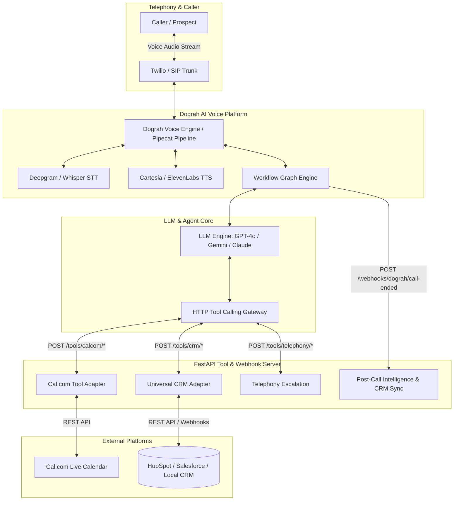
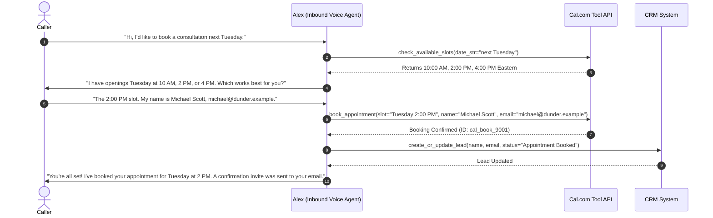
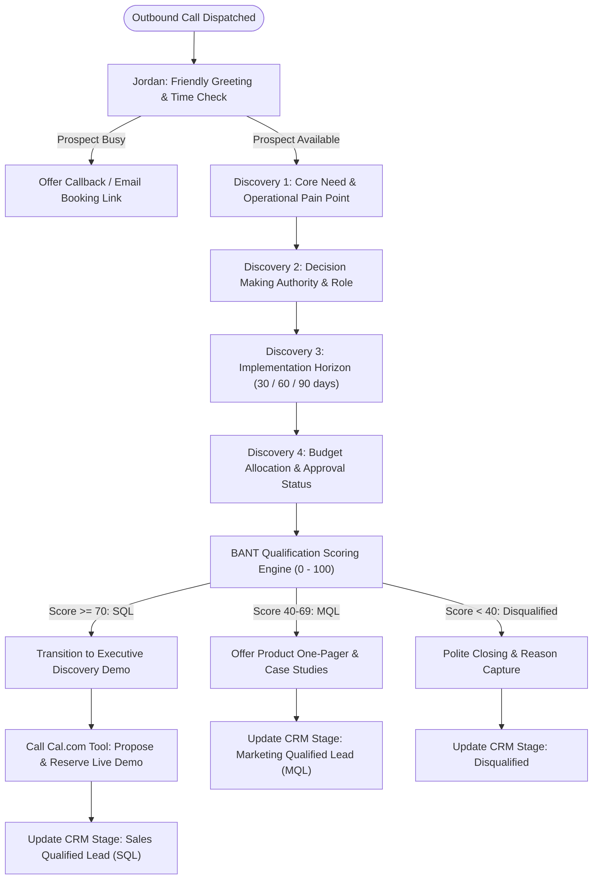

# AI Voice Agent – Inbound Booking & Outbound Lead Qualification

[](https://www.python.org/)
[](https://github.com/dograh-hq/dograh)
[](https://fastapi.tiangolo.com/)
[](https://cal.com)
[](#crm-integrations)
[](LICENSE)
[](tests/)

An enterprise-grade, conversational **Voice AI Agent platform** designed for **inbound appointment booking** and **outbound BANT lead qualification**, powered by **Dograh AI**, **Python**, **LLM APIs**, **Cal.com**, and **CRM systems**.

---

## 📌 Executive Summary & Key Highlights

* **Dual Conversational Voice AI Agents**:
  * **Inbound Booking Agent (`Alex`)**: Handles high-volume customer inquiries, resolves availability conflicts, books appointments in real time on Cal.com, manages cancellations, and triggers warm transfers to human agents.
  * **Outbound Lead Qualification Agent (`Jordan`)**: Runs context-aware phone calls using the **BANT** (Budget, Authority, Need, Timeline) framework, scores leads dynamically (0–100), and auto-schedules discovery meetings on Cal.com for qualified leads (SQLs).
* **Dograh AI Native Architecture**:
  * Programmatic graph builder creating Dograh-compliant visual workflow blueprints (`startCall`, `agentNode`, `webhook`, `endCall`).
  * 1-click importable JSON schemas (`workflows/inbound_booking_workflow.json` & `workflows/outbound_qualification_workflow.json`) for the Dograh visual canvas.
  * Automated Python deployment engine via `DograhClient`.
* **LLM-Powered Mid-Call Tool Calling**:
  * Real-time slot lookups and bookings against **Cal.com REST API** with conversational spoken date parsing ("next Tuesday afternoon").
  * Bi-directional CRM synchronization (**HubSpot**, **Salesforce**, **Pipedrive**, and **Local JSON CRM** for offline testing).
* **Telephony & Speech Optimizations**:
  * Sub-second response handling with natural conversational turn-taking cues and backchannel fillers ("Got it", "Let me check that slot for you").
  * Full interruption support (`allow_interrupt: true`) and Answering Machine Detection (AMD) voicemail drop logic.
* **Interactive CLI & Conversation Simulator**:
  * Test dialogues in real-time right in your terminal with colored live tool execution badges and score tracking.

---

## 🏗️ System Architecture



---

## 🔄 Conversation Flows

### 1. Inbound Appointment Booking Flow



### 2. Outbound BANT Lead Qualification Flow



---

## 📂 Repository Structure

```
AI-Voice-Agent-Booking-Lead-Qualification/
├── .github/
│   └── workflows/
│       └── ci.yml                        # GitHub Actions CI for multi-python testing
├── config/
│   ├── __init__.py
│   └── settings.py                       # Pydantic v2 application configuration
├── data/
│   └── mock_crm_database.json            # Local JSON CRM database seed
├── scripts/
│   ├── run_server.py                     # Start FastAPI tool and webhook server
│   ├── simulate_inbound_call.py          # Interactive/automated Inbound simulator
│   ├── simulate_outbound_call.py         # Interactive/automated Outbound simulator
│   └── deploy_dograh_workflows.py        # Programmatic deployment to Dograh AI
├── src/
│   ├── __init__.py
│   ├── agents/
│   │   ├── __init__.py
│   │   ├── base_agent.py                 # Abstract agent base class
│   │   ├── inbound_booking_agent.py      # Alex - Inbound Booking Agent
│   │   ├── outbound_lead_agent.py        # Jordan - BANT Lead Qualification Agent
│   │   └── prompts.py                    # Voice-tuned system prompts & guardrails
│   ├── dograh/
│   │   ├── __init__.py
│   │   ├── client.py                     # Dograh REST API Client / SDK wrapper
│   │   ├── deployer.py                   # Automated workflow deployment runner
│   │   ├── schemas.py                    # Pydantic models for Dograh Nodes & Edges
│   │   └── workflow_builder.py           # Programmatic visual workflow constructor
│   ├── server/
│   │   ├── __init__.py
│   │   ├── app.py                        # FastAPI application instance & middleware
│   │   ├── routes_health.py              # Health check & diagnostics
│   │   ├── routes_tools.py               # Mid-call HTTP endpoints invoked by Dograh
│   │   └── routes_webhooks.py            # Post-call analysis & Cal.com webhook sync
│   ├── simulator/
│   │   ├── __init__.py
│   │   └── voice_simulator.py            # Rich terminal voice conversation simulator
│   ├── tools/
│   │   ├── __init__.py
│   │   ├── calcom_tool.py                # Cal.com API availability & booking client
│   │   ├── crm_tool.py                   # Universal CRM adapter (HubSpot, Salesforce, Mock)
│   │   ├── qualification_engine.py       # BANT scoring algorithm (Budget, Authority, Need, Timeline)
│   │   └── telephony_tool.py             # Human escalation & AMD voicemail drop
│   └── utils/
│       ├── __init__.py
│       ├── date_parser.py                # Conversational date & time parser
│       ├── logger.py                     # Rich formatted color logger
│       └── phone_utils.py                # E.164 phone formatting & sanitization
├── tests/
│   ├── conftest.py                       # Pytest fixtures and test client
│   ├── test_calcom_tool.py               # Cal.com slot lookup and booking tests
│   ├── test_conversation_flows.py       # Multi-turn conversation logic tests
│   ├── test_crm_tool.py                  # CRM lead lookup, update, and call log tests
│   ├── test_dograh_workflow.py           # Dograh workflow graph schema validation
│   ├── test_qualification_engine.py      # BANT scoring & lifecycle stage tests
│   └── test_server_routes.py             # FastAPI integration endpoint tests
├── workflows/
│   ├── inbound_booking_workflow.json     # Dograh visual blueprint for Inbound Booking
│   └── outbound_qualification_workflow.json # Dograh visual blueprint for Outbound Lead Qualifier
├── .env.example                          # Environment variables template
├── .gitignore                            # Comprehensive gitignore
├── docker-compose.yml                    # Docker Compose stack definition
├── Dockerfile                            # Production container image
├── LICENSE                               # MIT License
├── pyproject.toml                        # Package configuration
├── README.md                             # Documentation & user guide
└── requirements.txt                      # Dependencies list
```

---

## 🚀 Quickstart Guide

### 1. Prerequisites
* Python 3.10+
* Git

### 2. Clone & Install Dependencies
```bash
git clone https://github.com/TRISHNA-K/AI-Voice-Agent-Booking-Lead-Qualification.git
cd AI-Voice-Agent-Booking-Lead-Qualification

python -m venv .venv
# On Windows:
.venv\Scripts\activate
# On Linux/macOS:
source .venv/bin/activate

pip install -r requirements.txt
```

### 3. Configure Environment
```bash
cp .env.example .env
```
*(By default, the project is configured with zero-dependency mock mode so you can run and test everything immediately without needing paid API keys!)*

---

## 🎙️ Running Voice Simulators in Terminal

You can experience the voice conversations directly in your terminal:

### Inbound Appointment Booking Simulation
```bash
python scripts/simulate_inbound_call.py
```
*To chat interactively in real time with the voice agent:*
```bash
python scripts/simulate_inbound_call.py --interactive
```

### Outbound Lead Qualification Simulation
```bash
python scripts/simulate_outbound_call.py
```
*To play the role of the prospect and test BANT qualification:*
```bash
python scripts/simulate_outbound_call.py --interactive
```

---

## 🌐 Running the FastAPI Tool & Webhook Server

Launch the high-performance tool server that handles Dograh's mid-call HTTP tool calls and post-call analytics:

```bash
python scripts/run_server.py
```

The server will be available at `http://localhost:8000`:
* **Interactive OpenAPI Swagger Docs**: [http://localhost:8000/docs](http://localhost:8000/docs)
* **Health Check**: [http://localhost:8000/health](http://localhost:8000/health)
* **Diagnostic Status**: [http://localhost:8000/api/v1/status](http://localhost:8000/api/v1/status)

---

## 🛠️ Dograh AI Integration

### Option A: 1-Click Import into Dograh Dashboard
1. Open your Dograh visual dashboard.
2. Navigate to **Workflows** -> **Import Workflow**.
3. Select either:
   * `workflows/inbound_booking_workflow.json`
   * `workflows/outbound_qualification_workflow.json`
4. The canvas will render all nodes (`startCall`, `agentNode`, `webhook`, `endCall`), conditional transition edges, and registered tool schemas.

### Option B: Deploy Programmatically via Python SDK
```bash
python scripts/deploy_dograh_workflows.py
```

---

## 📊 BANT Lead Qualification Framework

The outbound agent continuously scores leads across 4 dimensions:

| Dimension | Points | Scoring Criteria |
| :--- | :---: | :--- |
| **Need** | 0 – 25 | Critical pain point (unanswered calls, revenue loss) = 25; Moderate interest = 15; Casual = 8 |
| **Authority** | 0 – 25 | Sole Decision Maker (CEO, Founder, VP, Director) = 25; Committee member = 18; Non-decision maker = 8 |
| **Timeline** | 0 – 25 | Immediate / < 30 days = 25; 1–3 months = 20; 3–6 months = 12; > 6 months = 5 |
| **Budget** | 0 – 25 | Explicit budget allocated ($25k+) = 25; Flexible/funded = 18; Exploring = 12; Free/no budget = 5 |

### Lifecycle Routing:
* **Score >= 70 (SQL)**: Agent pitches and books an executive discovery walkthrough on Cal.com on the spot.
* **Score 40–69 (MQL)**: Agent collects follow-up preferences and triggers a marketing nurture campaign in CRM.
* **Score < 40 (Disqualified)**: Agent politely closes conversation and logs reason in CRM.

---

## 🧪 Running Automated Tests

Run the full pytest test suite (22 unit & integration tests):

```bash
python -m pytest -v
```

All 22 tests validate:
* Cal.com slot calculation, natural speech formatting, booking, and cancellation
* CRM CRUD, contact lookup, BANT scoring updates, and call logging
* BANT qualification engine thresholds & stage transitions
* Dograh workflow JSON schema integrity and tool definitions
* FastAPI REST tool calling endpoints and webhook receivers
* Multi-turn conversational state machines

---

## 🐳 Docker Deployment

Run the complete tool server inside Docker:

```bash
docker-compose up -d --build
```

Verify service status:
```bash
curl http://localhost:8000/health
```

---

## 📄 License

This project is licensed under the MIT License - see the [LICENSE](LICENSE) file for details.
